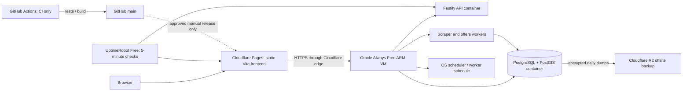

# MapNifique — readiness and hosting decision

**Review date:** 2026-11-14
**Repository:** `cheik23/MapNifique`, branch `main`
**Scope:** source/configuration review, local checks, and read-only review of the existing Vercel project. No production service, database, DNS record, secret, or cloud resource was changed.

## Decision

There is no verified zero-euro option that guarantees continuous service, durable PostGIS, and the current Playwright scraper without a home computer. The most compatible free experiment is a Cloudflare Pages frontend plus an Oracle Always Free ARM VM running the existing Docker services, with encrypted PostgreSQL dumps in R2. It is still **best effort**: Oracle can reclaim idle free compute, free capacity may be unavailable, and no service-level guarantee applies.

The first paid baseline worth evaluating is a cloud VM for the Fastify API and workers plus managed PostgreSQL/PostGIS with automatic backups. A single API VM remains a single point of failure. A higher availability target needs at least two application instances, a managed database with an appropriate SLA, independent backup/restore tests, and a budget agreed by the owner. It cannot promise literal 100% uptime.

No resources have been created. MapNifique is not yet operationally independent from the temporary API origin.

## What is operating now

- The Vercel project `mapnifique` is on the Hobby plan. Its latest production deployment is marked `READY`; `https://mapnifique.vercel.app` returned HTTP 200 and the expected HTML shell during the earlier read-only check.
- The Vercel production setting for the frontend API origin points to a `trycloudflare.com` host. Its value is intentionally not recorded here. The API `/health` request failed from this work environment; the cause and the origin machine were not established.
- A `trycloudflare.com` hostname identifies a **Quick Tunnel**, which Cloudflare documents as temporary and for testing/development. The URL works only while the `cloudflared` process and origin server are running; anyone who knows the URL can reach the service unless an additional access gate is configured. It is not a named tunnel and is not a production hosting plan. [Cloudflare Quick Tunnels](https://developers.cloudflare.com/tunnel/get-started/quick-tunnels/)
- Read-only Vercel Git context reports that this project is linked to `cheik23/MapNifique-`, not this repository `cheik23/MapNifique`. The latest deployment source is reported as `redeploy`. This repository push should therefore not trigger that Vercel project's Git deployment based on the metadata observed; no Vercel setting was changed.
- Compose currently defines PostgreSQL/PostGIS, Fastify API, scraper worker, offers worker and an optional OSM sync service. It binds the API to loopback and does not publish the database port. It is local development configuration, not a production deployment.
- The app already has a React/Vite frontend, MapLibre, search/category UI, route UI and offer/catalogue UI. Favorites are stored in browser `localStorage`; there is no account service or cross-device favorite sync. A catalogue view can be empty; no real offer feed was verified in this work.
- No cloud worker, hosted PostGIS database, public stable API origin, cloud scheduler, restore-tested backup, or availability alert has been verified for this repository.

## Confirmed implementation findings

1. The search SQL read `places.location`, but `initPlacesDb()` creates `places` with `lat` and `lon` and no `location` column. This breaks the local SQL search against a fresh schema. The SQL now constructs geography from `lon`/`lat` instead; regression assertions were added. A live PostGIS execution was not available, so SQL execution still needs an integration test.
2. Search SQL also reads `public.osm_places`. The normal Compose start does not run `osm-catalog-init.sql`; the optional `osm-sync` loop only runs replication updates and does not perform the initial PBF import or initialize replication state. A database lacking the OSM catalog therefore cannot satisfy the SQL search. Intelligent search now continues to Photon/Overpass after local SQL failure, with an explicit warning in its response. This is a fallback, not a replacement for a verified and populated database.
3. `osm-catalog-init.sql` now enables `postgis` and `pg_trgm` before defining its catalog schema. This SQL was not executed against any database. Initial extract loading, replication-state creation, and licensing/attribution review remain operational tasks.
4. Scraper recovery now has a lease heartbeat, per-attempt lease token, delayed retry (up to three attempts by default) and stale-job reclaim logic. The additive migration `backend/scraper/migrations/20261114_scrape_job_leases.sql` is required on an existing database and was not executed. SQL/heartbeat unit tests cover the query contract, but no real PostgreSQL crash/reclaim scenario was run. A worker that loses its lease is prevented from finalizing the job, but browser cancellation at the loss of ownership remains to be implemented.
5. The offers validity changes require the manual migration in `backend/scraper/migrations/`. Existing production rows were not inspected, and the migration was not run. Public API queries now hide an offer from the day after `valid_until` in Europe/Paris; a background worker must still be live for status updates and one-year deletion.
6. Offer-to-place linkage is represented by nullable `offers.place_id` and `ON DELETE SET NULL`; store-scoped offers require a place ID. No production rows were available to validate existing links, duplicates, or source coverage.
7. `POST /api/sources`, `POST /api/crawls`, and `POST /api/offers` use a shared `PLACES_ADMIN_TOKEN`. That is a useful minimum guard, not a production identity/authorization design. `GET /api/crawls/:id` is public and may reveal task status/error text; review the payload before publishing it.
8. The API limiter is bounded but in memory and per process. Restarts reset it and multiple replicas do not share counters. Production needs an edge/WAF rate limit, request/body limits, server-side secrets, private DB networking and least-privilege DB roles.
9. Fastify request logging strips query strings, which reduces location leakage in application logs. Proxies, CDN and hosting access logs may still record full query URLs. Consider moving precise coordinates to request bodies or configuring provider-side log redaction and short retention.
10. The front end's Vite `VITE_*` settings are public by design; none may contain credentials. The admin token and DB credentials must remain in server-side secret storage.

## Hosting comparison

Values below are the official published plan limits checked on 2026-11-14; providers can change them. Free does not mean an uptime promise.

| Option | Price and limits | Docker / PostGIS | Workers, schedule and browser collection | Sleep, backups and practical fit |
|---|---|---|---|---|
| **Oracle Cloud Always Free** | $0 for eligible resources: up to 2 OCPU + 12 GB RAM ARM A1 compute; 200 GB combined block volume; five block-volume backups. Home-region capacity can be unavailable. Oracle may reclaim an instance idle for 7 days under stated CPU/network/memory thresholds. Free resources have no production SLA/support guarantee. A card/account verification may be required. [Resources](https://docs.oracle.com/en-us/iaas/Content/FreeTier/freetier_topic-Always_Free_Resources.htm), [FAQ](https://www.oracle.com/cloud/free/faq/) | Yes, on an Ubuntu ARM VM. PostgreSQL/PostGIS can be self-managed in Docker. Existing `node:22-bookworm` + Playwright/Chromium image has **not** been built or run on ARM; compatibility and memory use are unverified. | Long-running Fastify, Playwright and workers can run in Docker; use systemd/Compose restart policies and the offers worker schedule. OSM needs an initial import before replication. | Most compatible with the existing stack at $0, but no always-on guarantee, potential capacity/reclamation and the VM remains a single point of failure. Use offsite encrypted R2 backups; Oracle's own five backups are not independent. Best free prototype, not a guaranteed public service.
| **Cloudflare Pages + Workers / Queues / Cron** | Static Pages hosting costs $0 on Free; up to 500 builds/month, one concurrent build, 20,000 files/site and 25 MiB/file. Workers Free: 100,000 requests/day, 10 ms CPU/invocation, 128 MB memory, 5 Cron triggers/account. Queues: 10,000 operations/day, 24-hour retention. R2: 10 GB-month, 1M Class A + 10M Class B operations/month; Internet egress free. [Pages limits](https://developers.cloudflare.com/pages/platform/limits/), [Workers pricing](https://developers.cloudflare.com/workers/platform/pricing/), [Workers limits](https://developers.cloudflare.com/workers/platform/limits/), [Queues](https://developers.cloudflare.com/queues/platform/pricing/), [R2](https://developers.cloudflare.com/r2/pricing/) | Static frontend and JS/TypeScript Workers yes; Free Workers cannot run the existing Docker/Fastify service. A Worker API would require a significant rewrite. No native PostgreSQL/PostGIS database; connect to external managed PostgreSQL. Containers are not included in Free. | Cron/Queues can handle short tasks, not a continuous process. Browser Run Free is limited to 10 minutes/day, 3 concurrent browser sessions and low crawl request limits; this is not enough for general Playwright collection. [Browser Run limits](https://developers.cloudflare.com/browser-run/limits/) | No auto-sleep for static assets; Workers run on demand. Great for the frontend and edge protections; not sufficient alone for this Node + Playwright + PostGIS backend. R2 is a good free offsite target while backups remain within quotas.
| **Vercel Hobby** | $0; includes 1M function invocations, 4 active CPU-hours and 360 GB-hours provisioned memory (published quota). Hobby is limited to personal, non-commercial use. [Hobby](https://vercel.com/docs/plans/hobby), [limits](https://vercel.com/docs/limits) | Static Vite yes. Vercel supports Dockerfile-based HTTP containers in Functions, but they are stateless autoscaling functions and scale to zero. It is not a permanent worker host. [Container functions](https://vercel.com/docs/functions/runtimes/container) | Hobby Cron is at most once daily with ±59-minute precision; not enough for a six-hour worker schedule. Browser scraper in short functions is a poor fit. [Cron](https://vercel.com/docs/cron-jobs/usage-and-pricing) | No DB backup or PostGIS service by itself. Can remain an independent static frontend if usage is eligible, but cannot meet the current backend/worker requirement and commercial-use restriction must be assessed.
| **Supabase Free / Pro** | Free: $0, 500 MB DB, shared 500 MB RAM, 5 GB egress, 1 GB storage; two active projects; Free projects may pause after 7 days of low activity; no automatic backups. Pro: $25/month, includes $10 compute credits (enough for one Micro project), 8 GB disk, 250 GB egress, daily backups retained 7 days; no auto-pause. [Pricing](https://supabase.com/pricing), [pause policy](https://supabase.com/docs/guides/platform/free-project-pausing), [backups](https://supabase.com/docs/guides/platform/backups) | PostgreSQL and PostGIS supported; no general-purpose Docker host. [PostGIS](https://supabase.com/docs/guides/database/extensions/postgis) | Edge Functions are short event/serverless functions; not a long-running Playwright scraper/worker. Needs a separate scheduler/worker host. | Free is unsuitable for guaranteed public production. Pro is a viable managed PostGIS component; daily backups are useful but still require restore drills and preferably a second copy offsite.
| **Neon Free / paid usage-based** | Free $0, no card per current pricing: 100 projects, 100 CU-hours/project/month, 1 GB/project, up to 2 CU; compute suspends to zero after 5 minutes inactive. Free instant restore is limited (up to 6 hours or 1 GB changes, one snapshot); usage/storage/network caps apply. [Pricing](https://neon.com/pricing) | Managed PostgreSQL with PostGIS available; cannot host the existing Docker scraper. [PostGIS](https://neon.com/docs/extensions/postgis) | Neon Functions are not a general-purpose Playwright worker service. Pair it with a separate compute/scheduler platform. | Useful for staging or a low-duty database; scale-to-zero and quotas can delay/fail live requests, so it does not meet strict always-available requirements. External dumps still needed for durable recovery.
| **Render Free** | $0 web service; 750 free instance-hours/workspace/month; 1 GB Postgres. | Docker web service supported; PostGIS version/extension and resource suitability need validation. | Web services sleep after 15 min idle and take about a minute to restart; free service cannot run one-off jobs. | Free Postgres expires after 30 days, has no backups; Render explicitly says not to use Free services for production. Reject for production. [Free limits](https://render.com/docs/free)
| **Google Cloud Run Free Tier** | Up to 2M requests/month, 360k GB-seconds memory, 180k vCPU-seconds and 1 GB North American egress; a billing account is required and overages are chargeable. [Free tier](https://docs.cloud.google.com/free/docs/free-cloud-features) | Docker/OCI HTTP service yes; no included managed PostGIS database. Cloud SQL is separately paid. | Request/event-driven jobs can run within quota but scale to zero. A scheduled service still needs Cloud Scheduler/other trigger and database; worker time/egress can exceed free allowance. | Not always-on, North-America-only egress allowance, billing/overage risk. Good for trials, not the required guarantee.
| **GitHub Actions** | GitHub Free private repositories have an included monthly compute dollar allowance; excess can be billable unless a spending budget stops it. [Included usage](https://docs.github.com/en/billing/reference/product-usage-included) | CI runners support Docker; not a durable host or database. | Good for tests and builds. Scheduled actions can be delayed or dropped under load, so not production scheduling/worker infrastructure. [Schedule behavior](https://docs.github.com/en/actions/how-tos/troubleshoot-workflows) | Keep for CI only. The repository workflow added here has no deployment step; GitHub Actions billing budget settings are not inspected.

### Architecture A — best free, no guarantee



UptimeRobot Free currently lists 50 monitors and 5-minute checks; this detects some failures but does not guarantee recovery or an SLA. [Pricing](https://uptimerobot.com/pricing/). Daily backup, retention, encryption, alert destinations and restoration must be configured and tested. R2 free limits are not unlimited; storage/operations above them cost money.

### Architecture B — paid baseline and availability ceiling

```mermaid
flowchart LR
  U[Browser] --> CF[Cloudflare Pages / edge]
  CF -->|HTTPS| API[Cloud VM: Fastify API]
  CF -->|HTTPS| API2[Second API instance for failover]
  API --> DB[(Managed Supabase PostgreSQL + PostGIS)]
  API2 --> DB
  W[Cloud VM worker(s): Playwright / offer jobs] --> DB
  DB -->|daily managed backup + separate encrypted dump| R2[Offsite object storage]
  MON[External uptime checks + alerting] --> API
  MON --> API2
  GH[GitHub Actions CI] --> GHRELEASE[Manual, gated release]
```

An indicative Hetzner CX33 list price after the 2026-06 price change is €8.49/month excluding VAT plus €0.50/month for primary IPv4 (or free IPv6). The public Cost-Optimized page currently marks CX33 unavailable, so this is **not a confirmed orderable quote**. [Price change](https://docs.hetzner.com/general/infrastructure-and-availability/price-adjustment/), [IPv4 price](https://docs.hetzner.com/cloud/servers/primary-ips/overview/). Supabase Pro adds $25/month before applicable taxes/extra usage, producing a starting component total of **€8.99 + $25/month before tax**, if capacity is orderable. A second similarly sized API VM approximately doubles the VM component. Domain registration, possible tax/currency conversion, higher compute/storage/egress, email, monitoring upgrades and recovery storage can add cost.

Hetzner publishes a 99.9% monthly “commercially reasonable efforts” SLA for a Cloud Server, with credit only after the threshold; one VM is still a single point of failure. The estimate is a practical baseline, not a 100% uptime promise. [Hetzner Cloud SLA](https://docs.hetzner.com/general/company-and-policy/slas-cloud/). For a stronger target, use redundant app instances, managed DB with the required plan/SLA, health checks, tested restore and an owner-approved budget. The minimum cost for a true multi-zone design is not determined without region, traffic, data size and recovery-time targets.

## Security and privacy gates before public API exposure

- Keep database networking private. Public users should reach only the HTTPS frontend/API, never PostgreSQL.
- Move `PLACES_ADMIN_TOKEN` to cloud secret storage, use a high-entropy value, rotate it, and limit admin access further (identity-based auth, IP/WAF rule or a private admin path). Do not add it to `VITE_*`, Git, build artifacts, logs, or URLs.
- Split public read access from admin writes. Introduce account authentication only if user-synced favorites are added; current favorites are local to one browser. Do not create accounts/PII until purpose, retention, deletion/export and provider responsibilities are chosen.
- Add a distributed edge limiter/WAF; current per-process counters do not protect multiple replicas or volumetric traffic. Set ceilings for search radius/page size, request body size and external provider fan-out.
- Review public `GET /api/crawls/:id` response fields and logs so task errors do not expose internal paths, upstream URLs or exception details. Public source catalog visibility should be deliberate.
- Reduce exact GPS data in URLs and logs. Fastify redaction does not prove that Vercel, Cloudflare or other upstream access logs omit query strings. Use TLS and a short, documented retention period.
- Give the runtime database role only required read/write privileges. A separate migration/admin identity should own schema changes; current startup code executes `CREATE TABLE`/`ALTER TABLE`, so production role separation needs a migration/startup design before launch.
- Keep backups encrypted, off-host, access-controlled and independent from the primary VM. Verify a restore into a separate test database; a successful dump alone is not a restore test.
- Review OSM attribution/licensing and tile, Photon, Nominatim, Overpass, route and catalogue-provider usage limits before increasing traffic or collection. Third-party availability and service policies remain external dependencies.

## Vulnerability review: minimatch / Crawlee

`npm audit --omit=dev` on `backend/scraper` reported **12 moderate dependency-tree findings**. It identifies `minimatch` 9.0.9 through `crawlee@3.18.2` / `@crawlee/core`; npm's advisory metadata reports `GHSA-g3hv-75wg-m249` and suggests remediation through a breaking Crawlee version change. The current GitHub advisory page describes affected `minimatch` 10.2.6 and a fix in 11.0.1, which does not match the installed 9.0.9 report. This version-range discrepancy needs upstream/advisory clarification. [GitHub advisory](https://github.com/isaacs/minimatch/security/advisories/GHSA-g3hv-75wg-m249)

No override or major dependency upgrade was applied. The crawler code reviewed here does not pass user-supplied glob patterns into Crawlee, so exploitability in this app is not established; the moderate audit finding remains open. Re-run the audit after upstream compatibility releases and verify the dependency tree before remediation.

## Migration and release order

1. Owner chooses the free best-effort route or approves a monthly cost ceiling and availability target for the paid route. No resources should be created before this choice.
2. Build and integration-test a disposable cloud-compatible staging stack; first verify `places`/PostGIS schema, OSM bootstrap, source coverage, offer-to-place links, retention boundaries, retries, Docker ARM/x86 compatibility and restart behavior.
3. Define controlled schema migrations, inspect a sanitized production-shaped export, and take a verified backup before any live migration. Apply nothing to an existing production database until the owner approves the exact migration and backup/rollback plan.
4. Provision staging resources only after owner approval. Store secrets in server-side platform storage, make the database private, enable edge protections, set spend limits and deploy from GitHub with CI checks. CI is not production cron.
5. Configure import/scraping schedules, lawful source limits, one-year expiry cleanup, encrypted external backups, restore drills, availability alerts and worker restart/retry semantics. Test each automatically after restart and after simulated failure.
6. Run browser-to-API-to-PostGIS end-to-end checks from desktop and mobile, including map tiles, GPS permissions, search, offers, routes, error states and an empty database. Confirm real data and sources, not fixture-only results.
7. Present the new staging URLs, health checks, backup restore evidence, cost quotas and rollback procedure. Obtain separate owner approval before production deployment, changing the production API setting or DNS, or retiring the Quick Tunnel.
8. Switch traffic only after all gates pass. Keep the previous origin available through a defined rollback window; remove it only after a verified production period and owner approval.

## Tests and limitations of this review

- Backend: 110 tests passed; backend syntax check passed.
- Frontend: TypeScript/Vite build passed. Frontend lint exited successfully with 12 React hook/dependency warnings. Vite reports a large JavaScript chunk (~1.13 MB); consider route-level code splitting.
- Production dependency audit: frontend reported no production advisories; backend reported the moderate Crawlee/minimatch tree above. No risky upgrade was applied.
- GitHub Actions workflow is added but has not run on GitHub yet. It performs CI only; no deploy step exists.
- No Docker image build was possible because the Docker Desktop engine was unreachable from this session. No ARM build, live PostGIS integration, production DB introspection, migration execution, scraper browser run, data-source collection test, scheduled cloud job, backup restore, mobile browser test or new cloud deployment was completed.
- The API health request did not succeed from this environment. It is not valid to claim the current API is down or up based solely on that failed request.
